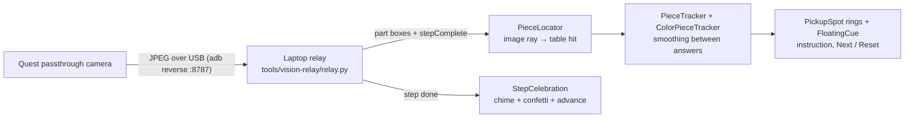

# Forge XR

Guided assembly in mixed reality for Meta Quest 3/3S, built at a 36-hour XR hackathon (Work track).

A builder wears the Quest at a table with loose LEGO pieces (set 40650, Land Rover Classic Defender). In passthrough, Forge finds the real pieces with the headset camera, rings the one to pick up next, floats the instruction above it, and advances on its own when it sees the step assembled. Pinch **Next** or press a controller button at any time to advance yourself. The success test is a first-time builder finishing without coaching.

## How it works



1. **Camera frames.** `CameraFrameSource` reads passthrough CPU images (Unity OpenXR: Meta camera subsystem). `PassthroughCameraModel` gets the lens pose from Android Camera2 over JNI, because the Meta OpenXR package has no C# API for it.
2. **Detection on the laptop.** `CloudVisionClassifier` POSTs each frame to the relay with the current walkthrough state. The relay answers with normalized boxes per part ID. It runs one of three detectors:
   - `local`: fine-tuned YOLO (Ultralytics), with an ensemble of two weight files by default. This is the demo default.
   - `nvidia`: NVIDIA Nemotron VL (`nemotron-3.5-super-vl-120b-a12b`). Cloud-hosted and rate limited.
   - `hybrid`: local, plus a background Nemotron check every few seconds.
3. **Placement on the table, no markers or manual alignment.** `PieceLocator` casts the box center through the camera intrinsics and pose. `TableSurface` finds where that ray meets the table, using Space Setup planes, the observed fingertip height, or a head-height fallback. `PieceTracker` smooths and de-jitters each part. `ColorPieceTracker` follows pieces by color histogram between detector answers. `ForgeHands` keeps a piece's ring while a hand covers it.
4. **Walkthrough and UI.** `QuestWalkthroughDriver` runs Harley's `DemoWalkthrough` (Driver + Wheel) headlessly. It picks the walkthrough from the parts it sees on the table, highlights the step's parts through `HighlightRegistry`, and pushes `n/N: instruction` to `FloatingCue`. There are no reference photos on Quest; those are in the desktop scenes only.
5. **Automatic step completion.** `step_check.py` on the relay watches for the step's two parts touching for a moment. It then confirms with a yes/no question to the VLM, or falls back to geometry alone when the VLM is unavailable. It tags the answer with `stepComplete`, and `StepCelebration` plays a chime and confetti and advances.

## Walkthroughs

| Walkthrough | Steps | Parts detected | Auto-complete |
| --- | --- | --- | --- |
| **Driver** minifigure | 3: torso onto legs → head → hair | legs, torso, head, hairpiece | Yes |
| **Wheel** on chassis | 3: pick up tire + rim → fit tire on rim → press onto axle pin | tire only (rim and axle pin are not detected) | No; use **Next** for steps 2–3 |

Part IDs are shared between Unity and the relay in `ForgeContracts.cs` and `relay.py`: `legs`, `torso`, `head`, `hairpiece`, `tire`, `rim`, `axle-pin`.

## Repository layout

| Path | What it is |
| --- | --- |
| `ForgeXR/` | **The Quest app.** Unity 6 project; build scene `Assets/Scenes/ForgeQuest.unity` |
| `ForgeXR/Assets/ForgeXR/Quest/Scripts/` | Runtime: camera, placement, tracking, highlights, input, walkthrough driver, celebration, remote config, diagnostics |
| `ForgeXR/Assets/ForgeXR/Quest/Editor/` | Idempotent scene setup steps (`[ForgeSetupStep]`, run in order: 100s passthrough, 200s pickup spots, 300s table planes, 400s input/UI, 500s camera + placement, 600s walkthrough + celebration, 900 diagnostics) |
| `ForgeXR/Assets/Editor/ForgeBuild.cs` | **Forge** menu and command-line build |
| `ForgeXR/Assets/ForgeXR/{Driver,Wheel}Walkthrough/`, `DemoWalkthrough.cs` | Walkthrough content and logic (shared with the desktop project) |
| `AssemblyWalkthroughs/` | Desktop-only Unity project for authoring and testing the walkthroughs with reference photos (`Assets/ForgeXR/ForgeDemo.unity`) |
| `Driver Walkthrough/` | Original driver asset package: stills, part reference photos, integration notes |
| `tools/vision-relay/` | Laptop relay, step judge, demo scripts, offline replay tools, tests |
| `context.md` | Project brief, division of labor, staging instructions |

## Requirements

**Quest app**
- Unity **6000.6.9f1** with Android Build Support (SDK, NDK, OpenJDK)
- Quest 3 or 3S in Developer Mode, USB debugging allowed, Space Setup done (for table planes)
- Key packages (already in the manifest): Unity OpenXR: Meta 2.6.1, OpenXR 1.18, XR Interaction Toolkit 3.6.1, XR Hands 1.9, AR Foundation 6.6.2, URP 17.6

**Laptop relay**
- `adb` on the PATH
- Python venv at `~/.venvs/forge-detector` with `ultralytics`, `requests` and `Pillow` (override with `FORGE_PY`)
- YOLO weights **outside the repo**: `~/forge-models/pieces-e12.pt` and `pieces-e5.pt` (override with `FORGE_WEIGHTS`)
- Optional, for `nvidia`/`hybrid` modes and the VLM step check: `NVIDIA_API_KEY` or `~/nvapi.env`

## Build the Quest app

Open `ForgeXR/` in Unity Hub and choose **Forge → Setup + Build Quest APK**. It runs every setup step, makes `ForgeQuest` the only build scene, and writes `ForgeXR/Builds/ForgeXR.apk` (package `com.forge.forgexr`, IL2CPP, ARM64).

From the command line:

```bash
Unity -batchmode -projectPath ForgeXR -buildTarget Android \
  -executeMethod ForgeBuild.BuildQuest -forgeSetup -quit
adb install -r ForgeXR/Builds/ForgeXR.apk
```

To change the scene, edit a setup step and re-run setup; don't hand-edit `ForgeQuest.unity`. Toggles live as `Enabled` constants in the setup files. For example, `Setup_FrameCapture` (the "Save frame" button) is off for the demo build, and `Setup_Diagnostics` is on.

## Run the demo

```bash
tools/vision-relay/start_demo.sh hybrid     # port forward, relay (local YOLO + Nemotron), app launch
tools/vision-relay/preflight.sh             # with the headset on, until it prints READY
```

Use `hybrid` in an unseen or bright room (it completed all three driver steps on its own in daylight); plain `start_demo.sh` runs the local detector only, `start_demo.sh nvidia` the cloud only. Open `http://127.0.0.1:8787/review` to see live annotated frames. The full checklist, operator commands and troubleshooting table are in [`tools/vision-relay/DEMO_RUNBOOK.md`](tools/vision-relay/DEMO_RUNBOOK.md).

**Controls**

| Action | Hands | Controllers | Editor |
| --- | --- | --- | --- |
| Next | pinch **Next** | right A or trigger | Space |
| Back | none | right B | Backspace |
| Reset | pinch **Reset** | hold left X for 1 s | R |
| Switch Driver/Wheel (locks auto-select) | none | left Y | W |

**Relay endpoints:** `POST /detect`, `GET /health`, `/review`, `/stats`, `/config`, `/step`, plus `POST /step/reset` and `POST /step/force` (operator override that marks the current step done).

**Live tuning without a rebuild:** edit `tools/vision-relay/quest_config.json` (the headset polls it every few seconds) or `tools/vision-relay/step_config.json` (re-read on change).

## Desktop walkthroughs

Open `AssemblyWalkthroughs/` in Unity 6000.6.9f1 and play `Assets/ForgeXR/ForgeDemo.unity`. Pick **Driver** or **Wheel**, then press Space or **Next**; **Reset** restarts. The standalone scenes are `DriverWalkthrough/DriverDesktop.unity` and `WheelWalkthrough/WheelDesktop.unity`. See [`AssemblyWalkthroughs/README.md`](AssemblyWalkthroughs/README.md).

## Offline tools (laptop only)

| Script | Use |
| --- | --- |
| `replay.py` | Re-run the current detector on saved frames and write an annotated grid |
| `step_replay.py` | Replay saved relay frames through the step judge to see when a step would complete |
| `label_frames.py` | Pseudo-label frames with Nemotron for detector training |
| `record_headset.sh` | Record what the wearer sees (`start`, `stop`, `pull`; no audio, keep videos out of git) |
| `test_step_check.py` | Unit tests for the step judge: `python3 -I tools/vision-relay/test_step_check.py` |

## Known limits

- The Wheel walkthrough only detects the tire, so its steps 2–3 need a manual **Next**. Keep wheel parts off the table during Driver; a stray tire can auto-switch the walkthrough.
- The headset must be tethered to the laptop over USB while the relay runs.
- If the app launches while the headset is asleep, Horizon mutes it. Relaunch while wearing it; `preflight.sh` checks for this.
- Detection quality depends on lighting. `pieces-e12` is tuned for the dim demo room; `pieces-e5` generalizes better to bright rooms.

## Work on other branches (not on `main`)

- `voice-assistant`: push-to-talk "what do I do next?" guidance (`tools/vision-relay/voice.py`)
- `ps/generated-walkthrough`: walkthroughs generated from the LEGO booklet PDF or a phone photo
- `ps/local-detector`: YOLO training pipeline (`tools/local-detector/build_dataset.py`, `self_label.py`, `zeroshot_test.py`)

## Data and privacy

Camera frames, relay logs, labels and model weights stay out of git (see `.gitignore`). Never commit captures from someone's space.

## Team

Phil (`pspannagel`): Quest deployment, passthrough, table placement, input. Harley (`MGhostHarley`): LEGO staging, reference photos, instruction copy, walkthrough logic and desktop scenes.

## License

MIT, see [`LICENSE`](LICENSE). Third-party Unity packages and samples keep their own licenses. LEGO is a trademark of the LEGO Group; this project is not affiliated with or endorsed by it.
