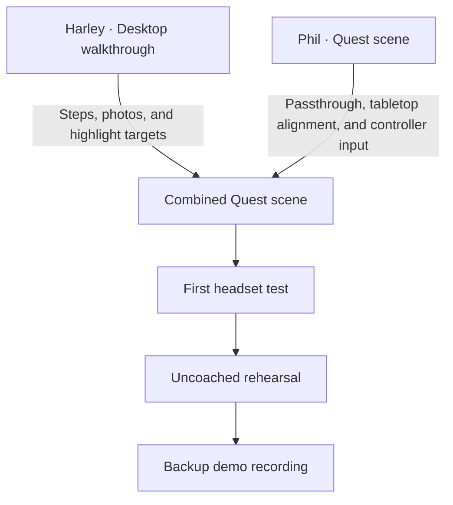

# Forge XR project context

Forge XR is a 36-hour hackathon prototype for the Work track. It uses a Meta Quest 3 and LEGO Creator Land Rover Classic Defender (set 40650) to demonstrate guided assembly at a physical workstation. In passthrough, Forge highlights the next part at its pickup spot, shows a reference photo, and advances when the builder presses Next. The success test is a first-time builder completing the walkthrough without coaching.

The initial handoff used a portable blender. The team switched to LEGO and is using the driver minifigure for the first headset test, with a wheel installation walkthrough as a second demo.

## Division of labor

Phil owns Quest deployment, passthrough, tabletop alignment, the Quest scene and project settings, and controller input. His first checkpoint is a torso label that stays aligned to its pickup spot as the wearer changes viewing angle.

Harley owns LEGO staging, reference photos, instruction copy, and the walkthrough logic and UI in a separate desktop test scene. Each step has an instruction, a photo, and one or more highlight targets. Space advances the desktop walkthrough.

Both use the same Unity editor version and forge-xr checkout. Pair for the first headset build and integration. The first joint milestone is one stable torso label, one placement cue, and one controller press that advances to the head highlight.

## Integration flow

Harley’s desktop walkthrough → step instructions, photos, and highlight targets → combined Quest scene

Phil’s Quest scene → passthrough, tabletop alignment, and controller input → combined Quest scene

Combined Quest scene → first headset test → uncoached rehearsal → backup demo recording

## Driver walkthrough

Stage the tan legs, blue torso, yellow head, and brown hair left to right, with the toes facing the builder. The loose-parts photo and booklet page are available. Three cleaned assembly stills and four loose-part references are included in the Unity project.

1. Highlight the legs and torso. Press the torso onto the legs with the shirt print facing the toes.

2. Highlight the head. Press it onto the neck with the face pointing forward.

3. Highlight the hair. Snap it onto the head and show the finished driver from the front.

## Wheel walkthrough

The chassis is built, and four tires and four rims are available. Stage one tire and one rim beside the chassis. Use the yellow pin on the left in the axle reference photo as the target, and keep the chassis in that orientation when staging.

1. Highlight the tire and rim. Pick up both pieces.

2. Fit the tire evenly around the rim. Show the assembled-wheel still for this cue.

3. Align the wheel’s center hole with the target axle pin and press it on. Check that it spins freely and show the mounted-wheel still. Use the close-up as the placement cue if the headset highlight drifts.

## Rehearsal and scope

Reset the pieces to their marked pickup spots between runs. Test alignment as the builder leans in. After the controller walkthrough works end to end, add “What do I do next?” so Forge can read the current instruction and trigger the same highlight. Keep part recognition and automatic assembly verification as stretch goals.

## Shared repository and Unity

[Forge XR](https://github.com/MGhostHarley/Forge-xr) (`MGhostHarley/Forge-xr`) is the default GitHub repository for this project. Its default branch is `main`. Use this repository for future Forge XR code and Unity asset changes unless the project owner directs otherwise. Phil (`pspannagel`) has Write access.

Open `DriverPrototype/` in Unity Hub with Unity `6000.6.9f1`. The desktop scenes are `DriverDesktop` and `WheelDesktop` under `Assets/ForgeXR`. Both include cleaned reference photos and support Space or Next to advance, plus Reset after completion. Phil’s Quest project lives on `ps/unity-hello-world` under `ForgeXR/`.

References: [Forge XR repository](https://github.com/MGhostHarley/Forge-xr) · [LEGO 40650 building instructions](https://www.lego.com/en-us/service/building-instructions/40650)
